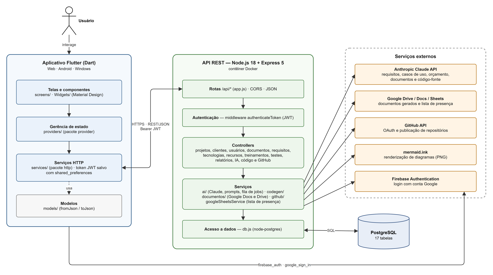
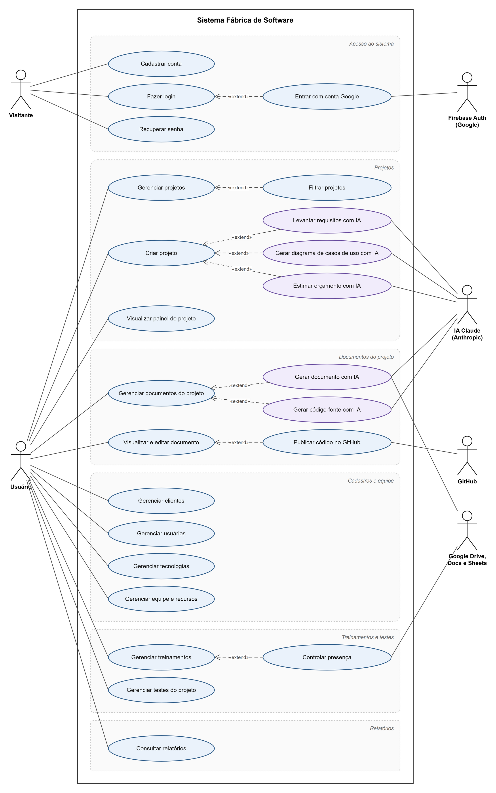
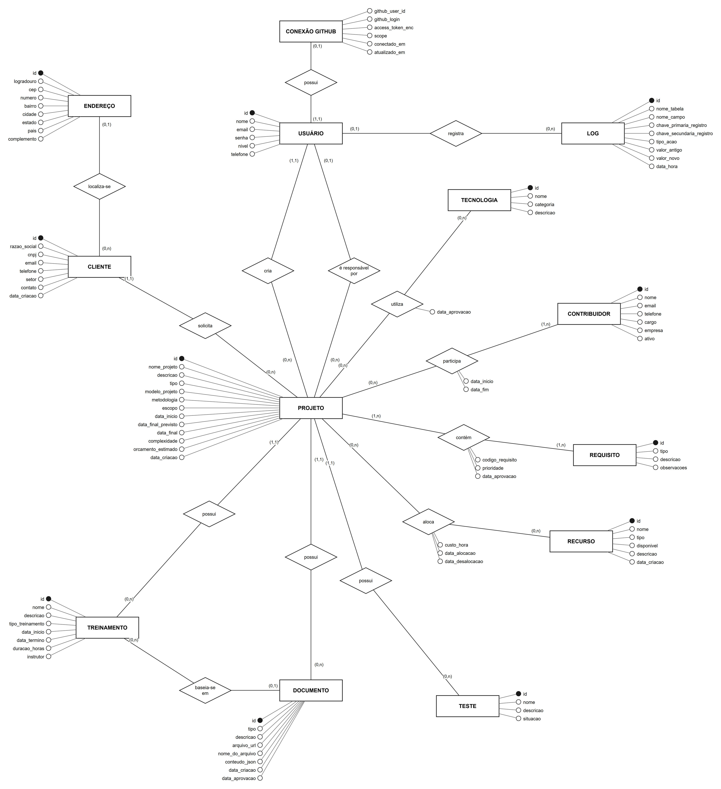
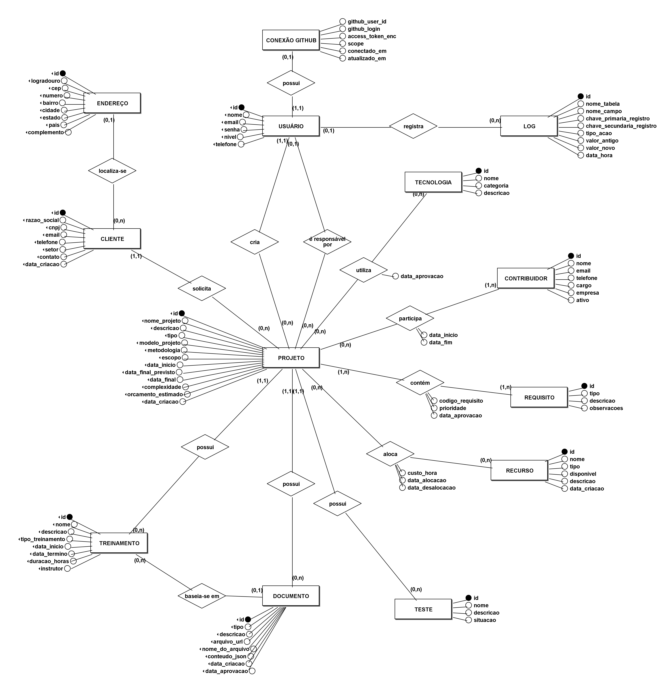
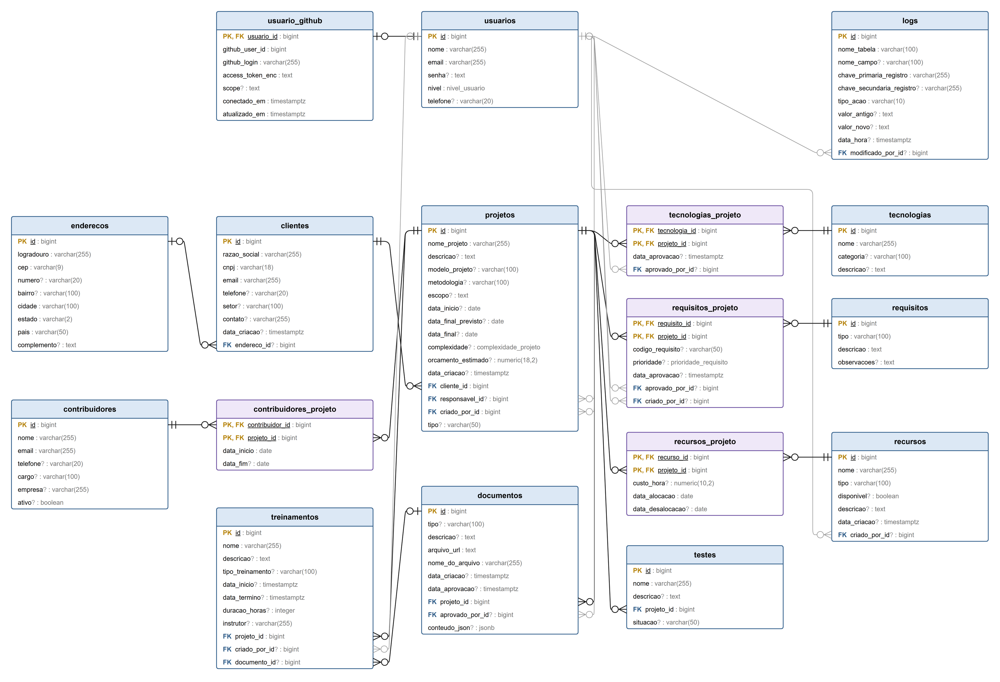
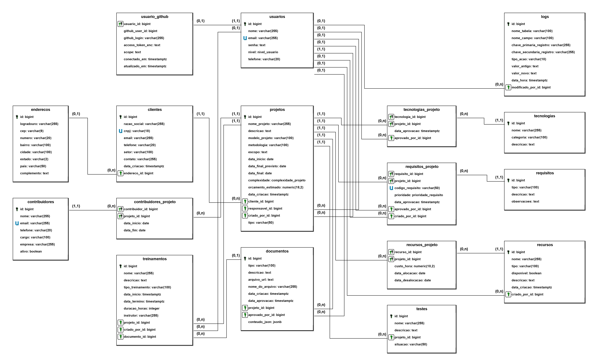
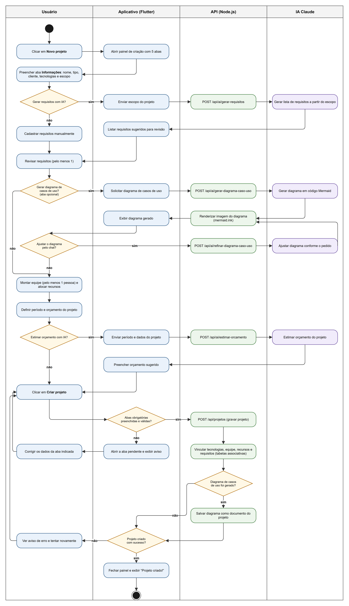

# Fábrica de Software — Backend (API REST)

[](https://github.com/elronyjunior/FabricaDeSoftware-Backend/actions/workflows/backend-test.yml)
[](https://github.com/elronyjunior/FabricaDeSoftware-Backend/actions/workflows/qualidade.yml)
[](https://github.com/elronyjunior/FabricaDeSoftware-Backend/actions/workflows/docker.yml)
[](https://github.com/elronyjunior/FabricaDeSoftware-Backend/actions/workflows/seguranca.yml)

API REST em **Node.js + Express** da plataforma **Fábrica de Software**: gestão de projetos de software com apoio de inteligência artificial (Claude, da Anthropic) para levantar requisitos, gerar diagramas, estimar orçamento, produzir documentação técnica e até gerar e publicar o código-fonte do projeto no GitHub.

> O aplicativo (front-end em Flutter) está em outro repositório: **[FabricaDeSoftware-Frontend](https://github.com/elronyjunior/FabricaDeSoftware-Frontend)**.

---

## Sumário

1. [Contexto do projeto](#1-contexto-do-projeto)
2. [Arquitetura](#2-arquitetura)
3. [Tecnologias](#3-tecnologias)
4. [Requisitos funcionais (RF)](#4-requisitos-funcionais-rf)
5. [Requisitos não funcionais (RNF)](#5-requisitos-não-funcionais-rnf)
6. [Regras de negócio (RN)](#6-regras-de-negócio-rn)
7. [Diagramas](#7-diagramas)
8. [Estrutura de pastas](#8-estrutura-de-pastas)
9. [Como rodar localmente (passo a passo)](#9-como-rodar-localmente-passo-a-passo)
10. [Testes](#10-testes)
11. [CI/CD — GitHub Actions](#11-cicd--github-actions)
12. [Principais rotas da API](#12-principais-rotas-da-api)
13. [Problemas comuns](#13-problemas-comuns)
14. [Geração de código com IA e publicação no GitHub](#14-geração-de-código-com-ia-e-publicação-no-github)

---

## 1. Contexto do projeto

Uma **fábrica de software** recebe pedidos de vários clientes e precisa, para cada projeto, levantar requisitos, montar a equipe, alocar recursos, estimar prazo e orçamento, produzir a documentação (especificação, casos de uso, arquitetura, modelagem, plano de testes…), treinar o cliente e acompanhar os testes. Esse trabalho costuma ficar espalhado em planilhas, documentos soltos e conversas.

A **Fábrica de Software** centraliza esse ciclo numa única plataforma e usa IA generativa para acelerar as etapas mais trabalhosas:

| Etapa do ciclo | O que a plataforma faz |
| --- | --- |
| Cadastro | Clientes (com endereço), usuários, tecnologias, contribuidores (equipe) e recursos. |
| Criação do projeto | Assistente em 5 abas: informações, requisitos, casos de uso, equipe e recursos, planejamento. |
| Requisitos | A IA sugere os requisitos a partir do escopo descrito; o usuário revisa e pode conversar com a IA para ajustar. |
| Casos de uso | A IA gera o diagrama de casos de uso (Mermaid → imagem) e ajusta pelo chat. |
| Orçamento | A IA estima o orçamento a partir do período, da equipe e da complexidade. |
| Documentação | A IA gera documentos técnicos completos (salvos no Google Drive/Docs) que podem ser editados por seção dentro do app, inclusive pedindo à IA para reescrever seções. |
| Código-fonte | A IA gera o código do projeto em camadas, a partir dos requisitos e documentos, e publica num repositório novo do GitHub de quem pediu. |
| Treinamentos e testes | Treinamentos do projeto com controle de presença (Google Sheets) e acompanhamento dos testes. |
| Gestão | Painel do projeto e relatórios (dashboard) com indicadores. |

**Público-alvo:** gestores e equipes de uma fábrica de software (gerentes de projeto, analistas e desenvolvedores).

**Este repositório** contém a API que o aplicativo consome: autenticação, regras de negócio, acesso ao banco PostgreSQL e integração com os serviços externos (Anthropic Claude, Google Drive/Docs/Sheets, Firebase Authentication, GitHub e mermaid.ink).

---

## 2. Arquitetura



- **Cliente:** aplicativo Flutter (web, Android e Windows) que chama a API por HTTPS/JSON enviando o token JWT no cabeçalho `Authorization: Bearer <token>`.
- **API (este repositório):** Express 5 organizado em camadas:
  - `app.js` — declara as rotas `/api/*`, CORS e o parser de JSON;
  - `controllers/` — uma pasta por recurso (projetos, clientes, documentos…), com a regra de cada rota;
  - `service/` — integrações e lógica mais pesada (IA, geração de código, GitHub, Google Docs/Sheets);
  - `db.js` — pool de conexões do PostgreSQL (`pg`).
- **Banco:** PostgreSQL com 17 tabelas (modelo lógico na seção 7).
- **Operações longas de IA** (gerar documento, retrabalhar seções, gerar código) rodam como *jobs* assíncronos: a rota responde `202 { jobId }` na hora e o app consulta `/status/:jobId` até terminar, sem estourar timeout de HTTP.

---

## 3. Tecnologias

| Camada | Tecnologia | Versão |
| --- | --- | --- |
| Runtime | Node.js | 20 (CI e Docker) |
| Framework HTTP | Express | 5 |
| Banco de dados | PostgreSQL (`pg` / node-postgres) | 16 no CI |
| Autenticação | JSON Web Token (`jsonwebtoken`), Firebase Admin (login com Google) | — |
| IA | Anthropic Claude (`@anthropic-ai/sdk`) | modelo padrão `claude-sonnet-4-5` |
| Google | `googleapis` (Docs, Drive, Sheets) | — |
| Diagramas | mermaid.ink (renderiza Mermaid em PNG) | — |
| Testes | Jest + Supertest | Jest 30 |
| Contêiner | Docker (`node:20-alpine`) | — |
| CI/CD | GitHub Actions + Dependabot | — |

---

## 4. Requisitos funcionais (RF)

Levantados a partir das rotas da API e das telas do aplicativo.

| ID | Requisito | Rotas principais |
| --- | --- | --- |
| RF01 | Cadastrar conta (nome, e-mail, senha, telefone) | `POST /api/auth/register` |
| RF02 | Fazer login com e-mail e senha, recebendo um token JWT | `POST /api/auth/login`, `POST /api/auth/refresh` |
| RF03 | Fazer login com conta Google (Firebase) | `POST /api/auth/google-login` |
| RF04 | Recuperar senha — **parcial**: a tela existe no app, a rota de envio de e-mail ainda não foi implementada | — |
| RF05 | Gerenciar usuários e seus níveis de acesso (USUARIO, MASTER, ADMINISTRADOR) | `/api/usuarios` |
| RF06 | Gerenciar clientes (CNPJ único) e seus endereços | `/api/clientes`, `/api/enderecos` |
| RF07 | Gerenciar projetos: listar, filtrar, criar, editar, excluir e ver o painel com os detalhes | `/api/projetos`, `/api/projetos/:id/detalhes` |
| RF08 | Criar projeto em etapas (informações, requisitos, casos de uso, equipe e recursos, planejamento) gravando todos os vínculos | `POST /api/projetos` + rotas de vínculo |
| RF09 | Gerar requisitos com IA a partir do escopo e refiná-los por chat | `POST /api/ai/gerar-requisitos`, `POST /api/ai/chat-requisitos` |
| RF10 | Gerar o diagrama de casos de uso com IA, ajustá-lo por chat e salvá-lo como documento | `POST /api/ai/gerar-diagrama-caso-uso`, `POST /api/ai/refinar-diagrama-caso-uso`, `POST /api/documentos/diagrama-mermaid` |
| RF11 | Estimar o orçamento do projeto com IA | `POST /api/ai/estimar-orcamento` |
| RF12 | Gerenciar tecnologias e vinculá-las ao projeto | `/api/tecnologias`, `/api/tecnologias-projeto` |
| RF13 | Gerenciar requisitos e vinculá-los ao projeto com código e prioridade | `/api/requisitos`, `/api/requisitos-projeto` |
| RF14 | Gerenciar contribuidores (equipe) e alocá-los no projeto | `/api/contribuidores`, `/api/contribuidores-projeto` |
| RF15 | Gerenciar recursos e alocá-los no projeto com custo/hora e período | `/api/recursos`, `/api/recursos-projeto` |
| RF16 | Gerar documentos técnicos do projeto com IA (salvos no Google Drive/Docs) | `POST /api/ai/gerar-documento` + `/status/:jobId` |
| RF17 | Visualizar e editar o conteúdo estruturado do documento, reescrever seções com IA e conversar com a IA sobre o documento | `/api/documentos/:id/conteudo`, `POST /api/ai/retrabalhar-secoes`, `POST /api/ai/chat-documento` |
| RF18 | Gerar o código-fonte do projeto com IA, em camadas | `/api/ai/gerar-codigo` (+ `/contexto`, `/status`) |
| RF19 | Conectar a conta do GitHub (OAuth) e publicar o código gerado num repositório novo | `/api/github/*`, `POST /api/documentos/:id/publicar-github` |
| RF20 | Gerenciar treinamentos do projeto e controlar a presença dos participantes (Google Sheets) | `/api/treinamentos`, `/api/treinamentos/:id/presenca` |
| RF21 | Gerenciar os testes do projeto e sua situação | `/api/testes` |
| RF22 | Consultar relatórios/dashboard com indicadores dos projetos | `GET /api/relatorios/dashboard` |
| RF23 | Registrar e consultar o log de alterações (auditoria) | `/api/logs` |

---

## 5. Requisitos não funcionais (RNF)

| ID | Categoria | Requisito |
| --- | --- | --- |
| RNF01 | Arquitetura | Sistema cliente-servidor: app Flutter multiplataforma + API REST stateless que troca JSON por HTTP(S). |
| RNF02 | Segurança | Todas as rotas, exceto login, cadastro, refresh e o callback do OAuth do GitHub, exigem token JWT válido (`Authorization: Bearer`); o token expira em 24 h. |
| RNF03 | Segurança | Segredos (banco, JWT, Firebase, chaves de IA e do Google/GitHub) ficam só em variáveis de ambiente, nunca no código; `.env` não é versionado e não entra na imagem Docker. |
| RNF04 | Segurança | O token do GitHub de cada usuário é guardado cifrado (AES-256-GCM) e nunca é devolvido ao front-end; o OAuth usa um `state` aleatório, de uso único e com prazo de validade, contra CSRF. |
| RNF05 | Persistência | PostgreSQL com integridade referencial (chaves estrangeiras, `ON DELETE CASCADE` nas tabelas de vínculo) e tipos enumerados para complexidade, prioridade e nível de usuário. |
| RNF06 | Desempenho | Operações de IA demoradas são assíncronas (job + consulta de status) para não bloquear a requisição nem estourar timeout. |
| RNF07 | Custo | A geração de código tem tetos configuráveis (arquivos, camadas, concorrência) para limitar custo e tempo; os testes automatizados nunca chamam a IA de verdade. |
| RNF08 | Confiabilidade | Erros da IA (limite de uso, saldo, sobrecarga) são traduzidos em mensagens claras para o usuário. |
| RNF09 | Testabilidade | Testes unitários e de integração (Jest + Supertest) contra um PostgreSQL descartável, executados a cada push e pull request. |
| RNF10 | Portabilidade | A API roda em contêiner Docker (`node:20-alpine`, usuário sem privilégios). |
| RNF11 | Manutenibilidade | Código organizado em rotas → controllers → serviços → acesso a dados; dependências atualizadas pelo Dependabot e auditadas semanalmente. |

---

## 6. Regras de negócio (RN)

| ID | Regra |
| --- | --- |
| RN01 | Todo projeto pertence a exatamente um cliente e é criado por um usuário; o responsável é opcional. |
| RN02 | O CNPJ do cliente e o e-mail do usuário/contribuidor são únicos. |
| RN03 | Para concluir a criação de um projeto são obrigatórios: nome, tipo e cliente; pelo menos 1 requisito; pelo menos 1 pessoa na equipe; período e orçamento maior que zero. A aba de casos de uso é opcional. |
| RN04 | A prioridade de um requisito no projeto é `baixa`, `media`, `alta` ou `critica`; a complexidade do projeto é `baixa`, `media` ou `alta`. |
| RN05 | Novos usuários recebem o nível `USUARIO`. |
| RN06 | Excluir um projeto remove em cascata seus vínculos, documentos, treinamentos e testes. |
| RN07 | Só pode haver uma geração de código em andamento por projeto (uma segunda recebe `409`). |
| RN08 | O código gerado pela IA nunca é executado no servidor; a publicação só cria repositórios novos e nunca apaga repositórios. |

---

## 7. Diagramas

Todos os diagramas estão em [`docs/diagramas/`](docs/diagramas), em três formatos editáveis:

| Pasta | Formato | Como abrir/editar |
| --- | --- | --- |
| [`png/`](docs/diagramas/png) | Imagem | Qualquer visualizador |
| [`drawio/`](docs/diagramas/drawio) | draw.io | [draw.io Desktop](https://github.com/jgraph/drawio-desktop/releases) ou [app.diagrams.net](https://app.diagrams.net) |
| [`brmodelo/`](docs/diagramas/brmodelo) | brModelo 3 (`.brM3` e `.xml`) | brModelo (Arquivo → Abrir) |
| [`mermaid/`](docs/diagramas/mermaid) | Mermaid (texto) | [mermaid.live](https://mermaid.live) ou um bloco ```` ```mermaid ```` no GitHub |

### Casos de uso


### Modelo conceitual (Peter Chen)


<details>
<summary>Versão gerada no brModelo</summary>


</details>

### Modelo lógico (gerado a partir de `db/schema.sql`)


<details>
<summary>Versão gerada no brModelo</summary>


</details>

### Diagrama de atividades — criação de projeto


O diagrama de classes (modelos do app) está no repositório do [front-end](https://github.com/elronyjunior/FabricaDeSoftware-Frontend).

---

## 8. Estrutura de pastas

```
FabricaDeSoftware-Backend/
├── app.js                  # Express: rotas /api/*, CORS e JSON
├── index.js                # Sobe o servidor na porta PORT
├── db.js                   # Pool de conexões do PostgreSQL
├── firebaseAdmin.js        # Inicialização do Firebase Admin (login com Google)
├── config/env.js           # Lê e valida as variáveis de ambiente
├── controllers/            # Uma pasta por recurso (projetos, clientes, documentos, ia, github...)
├── service/
│   ├── ai/                 # Claude: prompts, fila de jobs, tratamento de erros, render de diagramas
│   ├── codegen/            # Geração de código em camadas
│   ├── documentos/         # Validação e gravação de documentos
│   ├── github/             # OAuth, cliente da API e criptografia do token
│   ├── projetos/
│   ├── googleDocsService.js
│   └── googleSheetsService.js
├── db/
│   ├── schema.sql          # Estrutura do banco (usada no CI e para criar um banco novo)
│   ├── apply-schema.js     # Aplica o schema.sql num banco vazio
│   └── migrar-usuario-github.js
├── tests/
│   ├── unit/               # Testes unitários (sem banco)
│   ├── integration/        # Testes de integração (Supertest + PostgreSQL)
│   └── helpers/
├── scripts/verificar-sintaxe.js
├── docs/diagramas/         # Diagramas (PNG, draw.io, brModelo, Mermaid)
├── .github/                # Workflows do GitHub Actions e Dependabot
├── Dockerfile / .dockerignore
├── .env.example            # Modelo das variáveis de ambiente da API
└── .env.test.example       # Modelo das variáveis para rodar os testes
```

---

## 9. Como rodar localmente (passo a passo)

### 9.1 Pré-requisitos

| Ferramenta | Versão | Para quê |
| --- | --- | --- |
| [Git](https://git-scm.com/) | qualquer recente | clonar o repositório |
| [Node.js](https://nodejs.org/) | **20** (LTS) | rodar a API |
| [PostgreSQL](https://www.postgresql.org/download/) **ou** [Docker](https://www.docker.com/products/docker-desktop/) | PostgreSQL 16 | banco de dados |

Contas necessárias só para os recursos que dependem delas (a API sobe sem elas):

| Serviço | Usado em |
| --- | --- |
| [Anthropic](https://console.anthropic.com/) (chave de API) | Todos os recursos de IA |
| [Firebase](https://console.firebase.google.com/) (conta de serviço) | Login com Google |
| [Google Cloud](https://console.cloud.google.com/) (cliente OAuth com Docs, Drive e Sheets ativadas) | Documentos gerados e lista de presença |
| [GitHub OAuth App](https://github.com/settings/developers) | Publicar o código gerado (seção 14) |

### 9.2 Clonar e instalar as dependências

```bash
git clone https://github.com/elronyjunior/FabricaDeSoftware-Backend.git
cd FabricaDeSoftware-Backend
npm install
```

### 9.3 Subir o banco de dados

**Opção A — com Docker (mais simples):**

```bash
docker run -d --name fabrica-postgres -e POSTGRES_USER=postgres -e POSTGRES_PASSWORD=postgres -e POSTGRES_DB=fabrica_software -p 5432:5432 postgres:16
```

> Se você já tem um PostgreSQL instalado ocupando a porta 5432, troque para `-p 5433:5432` e use `DB_PORT=5433` no `.env`.

**Opção B — PostgreSQL instalado na máquina:** crie um banco vazio:

```bash
psql -U postgres -c "CREATE DATABASE fabrica_software;"
```

### 9.4 Configurar as variáveis de ambiente

```bash
cp .env.example .env
```

Abra o `.env` e preencha. O mínimo para a API **subir** é:

| Variável | O que colocar |
| --- | --- |
| `DB_HOST`, `DB_PORT`, `DB_USER`, `DB_PASSWORD`, `DB_NAME` | Dados do banco do passo 9.3 |
| `JWT_SECRET` | Um texto aleatório longo: `node -e "console.log(require('crypto').randomBytes(48).toString('hex'))"` |
| `FIREBASE_PROJECT_ID`, `FIREBASE_CLIENT_EMAIL`, `FIREBASE_PRIVATE_KEY` | Da conta de serviço do Firebase. Para testar sem login com Google, copie os valores falsos do `.env.test.example` |

Para os recursos opcionais:

- **IA:** `Claude_API` com a chave da Anthropic (e, se quiser, `CLAUDE_MODEL`).
- **Firebase (login com Google):** Console do Firebase → *Configurações do projeto* → *Contas de serviço* → **Gerar nova chave privada**. Copie `project_id`, `client_email` e `private_key` do JSON baixado (a chave inteira numa linha, com `\n` e entre aspas).
- **Google Docs/Drive/Sheets:**
  1. No Google Cloud Console, ative as APIs **Google Docs**, **Google Drive** e **Google Sheets** e crie um **ID do cliente OAuth** do tipo *App para computador*;
  2. cole o JSON baixado, numa linha só, em `GOOGLE_OAUTH_CLIENT_JSON`;
  3. rode `node controllers/Docs/setup_login.js`, faça login no navegador e cole no `.env` a linha `GOOGLE_API_TOKEN_JSON=...` que ele imprime.
- **GitHub:** veja a seção 14.

### 9.5 Criar as tabelas

```bash
npm run db:schema
```

O script aplica `db/schema.sql` no banco do `.env`. Se as tabelas já existirem, ele não faz nada.

### 9.6 Iniciar a API

```bash
npm run dev     # com recarregamento automático ao salvar
# ou
npm start
```

A API sobe em `http://localhost:3000`. Para conferir, uma rota protegida chamada sem token deve responder **401**:

```bash
curl -i http://localhost:3000/api/projetos
```

### 9.7 Criar o primeiro usuário

```bash
curl -X POST http://localhost:3000/api/auth/register -H "Content-Type: application/json" -d "{\"nome\":\"Admin\",\"email\":\"admin@exemplo.com\",\"senha\":\"123456\",\"telefone\":\"11999999999\"}"
```

O usuário nasce com o nível `USUARIO`. Para promovê-lo a administrador:

```bash
psql -U postgres -d fabrica_software -c "UPDATE usuarios SET nivel = 'ADMINISTRADOR' WHERE email = 'admin@exemplo.com';"
```

Agora é só abrir o [front-end](https://github.com/elronyjunior/FabricaDeSoftware-Frontend), que por padrão aponta para `http://localhost:3000/api`, e entrar com esse usuário.

### 9.8 Rodar com Docker (opcional)

```bash
docker build -t fabrica-software-backend .
docker run --env-file .env -p 3000:3000 fabrica-software-backend
```

> Dentro do contêiner, `localhost` é o próprio contêiner. Se o banco estiver na sua máquina, use `DB_HOST=host.docker.internal` no `.env`.

---

## 10. Testes

Os testes usam um banco **separado e descartável** — nunca aponte para o banco real, porque as suítes de integração apagam todas as tabelas entre um teste e outro.

```bash
# 1. Banco de teste (porta 5433 para não conflitar com um PostgreSQL local)
docker run -d --name fabrica-pg-teste -e POSTGRES_USER=postgres -e POSTGRES_PASSWORD=postgres -e POSTGRES_DB=fabrica_software_test -p 5433:5432 postgres:16

# 2. Variáveis de teste (ajuste DB_PORT=5433 no arquivo)
cp .env.test.example .env.test

# 3. Criar as tabelas no banco de teste
npm run db:test:schema:local

# 4. Rodar
npm test                 # unitários + integração
npm run test:coverage    # idem, com relatório de cobertura em coverage/
npm run check            # só verifica a sintaxe de todos os .js
```

O número de testes e a cobertura atualizados aparecem no resumo de cada execução do workflow **Backend Tests** (aba *Actions*). As chamadas de IA são sempre simuladas (*mock*), então os testes não gastam créditos da Anthropic.

> Os testes rodam em série (`--runInBand`) porque as suítes de integração compartilham o mesmo banco.

---

## 11. CI/CD — GitHub Actions

| Workflow | Quando roda | O que faz |
| --- | --- | --- |
| [`backend-test.yml`](.github/workflows/backend-test.yml) | push e PR em `main`/`develop`, manual | Sobe um PostgreSQL 16, aplica o schema e roda todos os testes com cobertura; publica o resumo da cobertura na página da execução e o relatório como artefato. |
| [`qualidade.yml`](.github/workflows/qualidade.yml) | push e PR em `main`/`develop`, manual | `npm ci` (falha se o `package-lock.json` estiver desatualizado), verifica a sintaxe de todos os `.js` e confere se toda variável de ambiente usada no código está documentada no `.env.example`. |
| [`docker.yml`](.github/workflows/docker.yml) | push e PR em `main`/`develop`, manual | Constrói a imagem Docker e faz um *smoke test*: sobe o contêiner e confirma que a API responde (rota protegida sem token → 401). |
| [`seguranca.yml`](.github/workflows/seguranca.yml) | toda segunda-feira, quando `package.json`/`package-lock.json` mudam, manual | Roda `npm audit` e publica a contagem de vulnerabilidades por severidade (informativo, não bloqueia). |
| [`dependabot.yml`](.github/dependabot.yml) | semanal | Abre PRs atualizando dependências npm, versões das Actions e a imagem base do Docker. |

Boas práticas aplicadas nos workflows: cache do npm, cancelamento de execuções antigas do mesmo branch (`concurrency`), disparo manual (`workflow_dispatch`) e **nenhum segredo real** no CI (credenciais falsas e IA simulada).

---

## 12. Principais rotas da API

Todas começam com `/api` e, exceto as de autenticação, exigem `Authorization: Bearer <token>`.

| Recurso | Rotas |
| --- | --- |
| Autenticação | `POST /auth/register`, `POST /auth/login`, `POST /auth/refresh`, `POST /auth/google-login` |
| Usuários | `GET/POST /usuarios`, `GET/PUT/DELETE /usuarios/:id` |
| Clientes e endereços | `GET/POST /clientes`, `GET /clientes/:id/detalhes`, `GET/PUT/DELETE /clientes/:id`, `/enderecos` |
| Projetos | `GET/POST /projetos`, `GET /projetos/cliente/:clienteId`, `GET /projetos/:id/detalhes`, `GET/PUT/DELETE /projetos/:id` |
| Vínculos do projeto | `/tecnologias-projeto`, `/requisitos-projeto`, `/contribuidores-projeto`, `/recursos-projeto` |
| Cadastros | `/tecnologias`, `/requisitos`, `/contribuidores`, `/recursos` |
| Documentos | `GET/POST /documentos`, `GET /documentos/projeto/:projetoId`, `GET/PUT /documentos/:id/conteudo`, `POST /documentos/diagrama-mermaid` |
| IA | `POST /ai/gerar-requisitos`, `/ai/chat-requisitos`, `/ai/gerar-diagrama-caso-uso`, `/ai/refinar-diagrama-caso-uso`, `/ai/estimar-orcamento`, `/ai/gerar-documento`, `/ai/retrabalhar-secoes`, `/ai/chat-documento`, `/ai/gerar-codigo` + `GET .../status/:jobId` |
| GitHub | `GET /github/status`, `POST /github/oauth/iniciar`, `GET /github/oauth/callback`, `DELETE /github/conexao`, `POST /documentos/:id/publicar-github` |
| Treinamentos | `/treinamentos`, `GET /treinamentos/:id/presenca`, `PUT /treinamentos/presenca/lote`, alunos e dias da planilha |
| Testes | `/testes`, `GET /testes/projeto/:projeto_id` |
| Relatórios e logs | `GET /relatorios/dashboard`, `/logs` |

---

## 13. Problemas comuns

| Sintoma | Causa e solução |
| --- | --- |
| `Variável de ambiente obrigatória ausente: X` ao iniciar | Falta `X` no `.env`. Compare com o `.env.example`. |
| `ECONNREFUSED 127.0.0.1:5432` | O PostgreSQL não está rodando ou está em outra porta. Confira o passo 9.3 e o `DB_PORT`. |
| `type "complexidade_projeto" already exists` | O `schema.sql` só pode ser aplicado num banco vazio. Use `npm run db:schema` (ele detecta banco já criado) ou recrie o banco. |
| Testes falhando com `viola restrição de chave estrangeira` | Os testes estão apontando para um banco com dados ou rodando em paralelo. Use um banco de teste vazio (seção 10) e `npm test` (já roda em série). |
| Rotas de IA respondem erro de limite/saldo | A chave da Anthropic atingiu o limite de gasto do *workspace* ou ficou sem créditos. Ajuste em console.anthropic.com → *Settings → Limits*. |
| Geração de documento falha no Google | `GOOGLE_API_TOKEN_JSON` ausente ou expirado: rode de novo `node controllers/Docs/setup_login.js`. |
| `401` em todas as rotas | Falta o cabeçalho `Authorization: Bearer <token>` ou o token expirou (24 h): faça login de novo. |

---

## 14. Geração de código com IA e publicação no GitHub

O backend gera o código-fonte de um projeto **em camadas** (a IA planeja os arquivos e escreve cada camada vendo o código real das anteriores) a partir dos requisitos, das tecnologias do projeto e dos documentos já gerados (API, Modelagem, Arquitetura, Casos de Uso, Código). O resultado é salvo como um documento do tipo `Código-Fonte` e pode ser publicado num repositório novo do GitHub de quem publicou.

| Rota | O que faz |
| --- | --- |
| `GET /api/ai/gerar-codigo/contexto/:projetoId` | Stack, documentos-fonte e nº de requisitos que serão usados |
| `POST /api/ai/gerar-codigo` | Inicia a geração (job assíncrono, responde `202 { jobId }`; `409` se o projeto já tem uma geração em andamento) |
| `GET /api/ai/gerar-codigo/status/:jobId` | Progresso (`stage`, `progress`) e resultado |
| `GET /api/github/status` | A conta GitHub do usuário está conectada? |
| `POST /api/github/oauth/iniciar` | Devolve a URL de autorização do GitHub |
| `GET /api/github/oauth/callback` | Retorno do OAuth (aberto pelo navegador, protegido pelo `state`) |
| `DELETE /api/github/conexao` | Desconecta o GitHub |
| `POST /api/documentos/:id/publicar-github` | Cria o repositório e envia todos os arquivos num único commit |

Como funciona: (1) uma chamada à IA planeja a arquitetura e os arquivos, agrupados em camadas, cada arquivo com uma `prioridade`; (2) as camadas são geradas em sequência (cada arquivo vê o código real das camadas anteriores) e os arquivos de uma camada, em paralelo; (3) uma verificação estática procura imports relativos (JS/TS) que apontam para arquivos inexistentes e gera só os que faltam; o que não puder ser consertado vira um aviso no arquivo que importa.

A IA nem sempre respeita os limites numéricos do prompt (num teste real planejou 42 arquivos/9 camadas para um teto de 30/6). Por isso, um plano acima dos limites é reduzido pelo próprio servidor, sem nova chamada: saem primeiro testes e documentação extra, depois os arquivos de menor prioridade (preferindo os que nenhum outro cita), e camadas vizinhas são fundidas; README, manifestos de dependências, `.env.example` e `.gitignore` nunca são cortados.

O código gerado **nunca é executado** no servidor e é sempre um ponto de partida para revisão.

### Variáveis de ambiente (todas opcionais)

| Variável | Padrão | Para que serve |
| --- | --- | --- |
| `CODEGEN_MAX_ARQUIVOS` | `30` | Máximo de arquivos por geração (teto 60) |
| `CODEGEN_MAX_CAMADAS` | `6` | Máximo de camadas (teto 10) |
| `CODEGEN_CONCORRENCIA` | `4` | Arquivos gerados ao mesmo tempo dentro de uma camada (teto 8); valores altos aceleram, mas aumentam o risco de rate limit (429) |
| `CLAUDE_MODEL_CODEGEN` | `CLAUDE_MODEL` | Modelo usado só para escrever os arquivos (o planejamento usa `CLAUDE_MODEL`) |
| `GITHUB_CLIENT_ID` / `GITHUB_CLIENT_SECRET` | — | Credenciais do OAuth App do GitHub |
| `GITHUB_TOKEN_ENC_KEY` | — | Chave AES-256 (32 bytes em base64) que cifra o token do GitHub no banco |
| `GITHUB_OAUTH_REDIRECT_URI` | `http://localhost:<PORT>/api/github/oauth/callback` | Callback registrado no OAuth App |

Sem as variáveis `GITHUB_*`, o servidor sobe normalmente e as rotas `/api/github/*` informam que a integração não está configurada.

### Habilitar a publicação no GitHub

1. No GitHub: *Settings → Developer settings → OAuth Apps → New OAuth App*. Em *Authorization callback URL* use o mesmo valor de `GITHUB_OAUTH_REDIRECT_URI` (por padrão `http://localhost:3000/api/github/oauth/callback`; em produção, uma URL pública HTTPS).
2. Gere um *client secret* e coloque no `.env` (nunca versione esse arquivo):

   ```
   GITHUB_CLIENT_ID=...
   GITHUB_CLIENT_SECRET=...
   GITHUB_TOKEN_ENC_KEY=<saída de: node -e "console.log(require('crypto').randomBytes(32).toString('base64'))">
   ```

   Trocar `GITHUB_TOKEN_ENC_KEY` depois invalida as conexões já salvas (cada usuário precisa reconectar o GitHub).
3. Crie a tabela que guarda o token cifrado de cada usuário (migração aditiva e idempotente, uma vez por banco; só cria, nunca altera nem apaga dados). O banco é escolhido explicitamente:

   ```bash
   node db/migrar-usuario-github.js --alvo=teste   # banco de testes (.env.test)
   node db/migrar-usuario-github.js --alvo=real    # banco do sistema (.env)
   ```

O escopo pedido ao GitHub é `repo` (necessário para criar o repositório e enviar os arquivos). O app só cria repositório novo e faz commits; ele nunca apaga repositórios.
